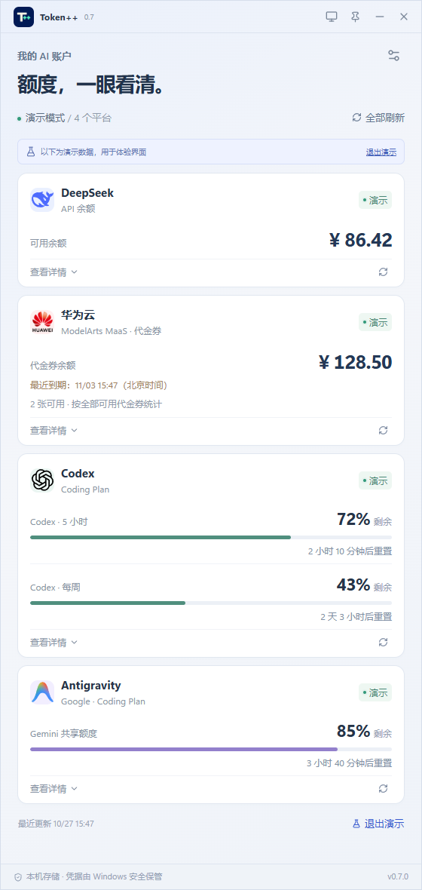
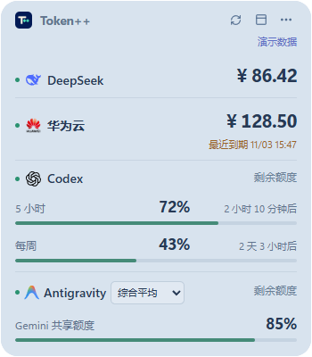

# Token++

**额度，一眼看清。** Windows 本地 AI 余额与订阅额度桌面组件。

当前版本 **0.7.1**，开发阶段。支持 DeepSeek、华为云代金券、Codex 和通过本机或云端 Antigravity Tools 获取的额度；平台逐个适配。



## 可以做什么

- 统一查看余额、代金券、订阅剩余百分比和重置倒计时，保持币种与额度类型独立。
- 支持多屏不同缩放与动态壁纸实时毛玻璃（在设置中开启），使用 Windows 原生合成，不启动屏幕采集。
- 桌面组件可拖动、精简显示，不占任务栏；提供毛玻璃/液态玻璃近似效果、字号、明暗和透明度设置。
- 完整面板查看明细，托盘随时恢复，可选窗口置顶与开机启动。
- 查询失败保留带过期标记的上次成功值，提供单个平台重试。
- 凭据放在 Windows 凭据管理器，界面不回显；没有集中账号服务器。



**展示图均为演示数据。** 默认静态模式使用壁纸文件；动态壁纸请在设置中开启实时毛玻璃。原生实时模式需要 Windows 11（22000+）并开启系统透明效果；Windows 10 使用静态背景模式。

## 下载与使用

在仓库的 **Releases** 下载 `TokenPlusPlus-版本号-setup.exe`，安装后从开始菜单或桌面快捷方式打开。安装仅针对当前 Windows 用户。也可使用同版本便携 EXE；日常使用无需 Node.js 或 Rust。当前安装包未签名，Windows 可能提示未知发布者。

1. 在设置中连接平台，密钥只在应用内输入。
2. 点击顶部显示器按钮进入桌面模式，拖动标题区域移动；菜单中调整材质、精简显示和位置锁定。
3. 关闭完整面板会收起到托盘，托盘可恢复面板或退出。
4. 设置 → 通用可开启开机启动，默认关闭、立即生效。建议先安装再开启；便携版移动后需重新开启。

支持 Windows 10/11 x64，依赖系统 WebView2 Runtime。实际兼容情况见 [平台支持](docs/PROVIDERS.md)。

## 连接平台

| 平台 | 连接方式 |
| --- | --- |
| DeepSeek | 官方 API Key，查询总余额、赠金和充值余额 |
| 华为云 | 账务查询 AK/SK，默认中国站；显示有效可用代金券 |
| Codex | 本机官方客户端/CLI 已登录，可自动发现或指定程序路径 |
| Antigravity | 填写 Tools 服务地址和管理密钥，选择账号/额度池或综合平均 |

华为云按全部可用代金券统计，**未筛选 MaaS 适用范围**，不保证合计都能用于模型抵扣。Antigravity Tools 是第三方来源，兼容性受其版本影响。

Codex 聊天窗口无需常驻，但查询会短时启动本机官方子进程；Tools 服务需运行。应用不发送模型推理请求。默认余额每 10 分钟、Codex 每 3 分钟、Tools 每 5 分钟刷新，可分别调整。

Antigravity 设置中的“Tools 服务地址”支持 `localhost:8045`、`http://127.0.0.1:8045`、`https://tools.example.com` 及带部署前缀的地址。可带 `/api`，不要填写 `/v1` 推理接口。非回环地址需使用 HTTPS，服务必须提供账号/额度管理接口；仅有中转 API Key 不保证能读取额度。密钥与服务地址绑定，修改地址后重新输入；原本机端口和凭据在升级时迁移。

桌面 Antigravity 标题旁下拉框可切换单账号或“综合平均”。综合使用各账号等权均值，五小时、每周和各额度池分别统计，不代表实际容量加权或剩余 Token；各账号独立重置。完整面板详情可查看统计口径与数据完整度。设置中的“显示项”可选择 Gemini Models、Claude & GPT Models 或两者，对所有账号与综合平均统一生效。切换选项静默保存，更新过程中保留上次结果并标明旧值，成功后整体替换。

详情、访问边界与查询来源见 [平台支持表](docs/PROVIDERS.md)。

## 本地数据

设置和最近成功快照位于 `%APPDATA%/com.tokenplusplus.desktop/state.json`（以系统实际应用数据目录为准）；凭据使用 Windows 凭据管理器中的 `TokenPlusPlus` 服务。设置中可移除对应凭据与快照。不要上传完整配置、账号截图或原始响应。

安装版与便携版共用本机配置。卸载默认保留设置，系统凭据可在应用内单独移除。开机启动使用当前 EXE 路径；托盘行为和桌面模式沿用上次偏好。

## 开发与贡献

需要 Node.js 24、Rust stable MSVC、Windows C++ Build Tools 和 WebView2。

```powershell
npm ci
npm run desktop
```

网页演示：`npm run dev`，不连接真实账号。构建安装包：`npm run desktop:package`。

- [贡献与测试](CONTRIBUTING.md)
- [新增平台指南](docs/ADDING_PROVIDER.md)
- [发布流程](docs/RELEASING.md)
- [安全报告](SECURITY.md)
- [更新记录](CHANGELOG.md)

## 许可证

[MIT](LICENSE) · Copyright (c) 2026 murainy。品牌与第三方资源见 [第三方声明](THIRD_PARTY_NOTICES.md)。本项目独立开发，平台标识不代表官方背书。

0.7.1 调整桌面/面板切换时的原生边框恢复，取消组件额外高度，并为 Windows 10 增加随尺寸和 DPI 更新的圆角裁剪。Windows 10 22H2 的实际修复效果等待目标机验收。
